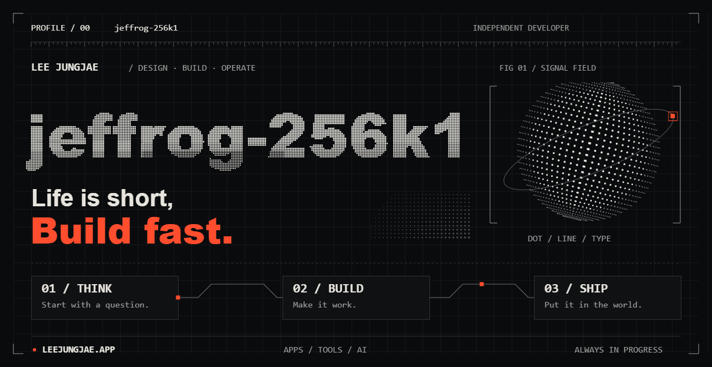

<a href="https://leejungjae.app">
  <picture>
    <source media="(prefers-reduced-motion: reduce)" srcset="assets/profile-static.png">
    
  </picture>
</a>

<a href="assets/profile-static.png">정지 이미지로 보기 · Still image</a>

### 이정재 · Jungjae Lee

아이디어를 직접 설계하고, 만들고, 운영합니다.  
앱과 도구, AI 제품을 만들며 배운 것을 기록합니다.

**Currently building → [jailbrain.ai](https://jailbrain.ai)**

[Website](https://leejungjae.app) · [Work](https://leejungjae.app/work) · [Log](https://leejungjae.app/log) · [Resume](https://leejungjae.app/resume)

---

### 01 / Selected work

**[leejungjae.app](https://leejungjae.app)** — 이력서 · 포트폴리오 · 개발 기록  
만든 것과 만드는 과정을 기록하는 개인 공간입니다. 작업, 경력, 글을 하나의 사이트에서 이어 볼 수 있습니다.

**[jailbrain.ai](https://jailbrain.ai)** — AI 워크스페이스 · 금융 AI 알파  
대화·코딩·미디어 작업과 시장 분석을 위한 AI 제품을 만들고 있습니다.

두 서비스의 소스코드는 비공개입니다. 공개된 서비스와 소개 자료를 통해 작업을 보여드립니다.

---

### 02 / Field notes

작은 실험부터 제품을 운영하며 배운 것까지.  
**[개발 기록 읽기 →](https://leejungjae.app/log)**

LEE JUNGJAE / JEFFROG-256K1 · Life is short, Build fast.
