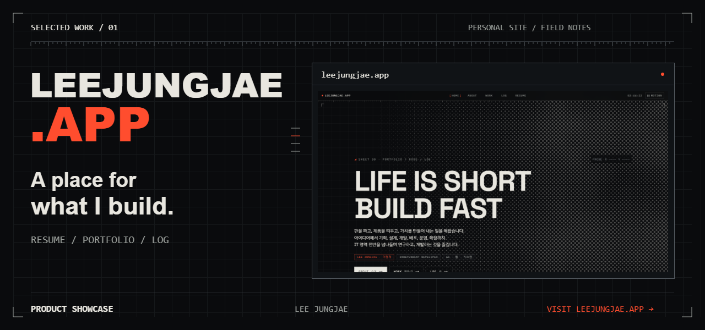
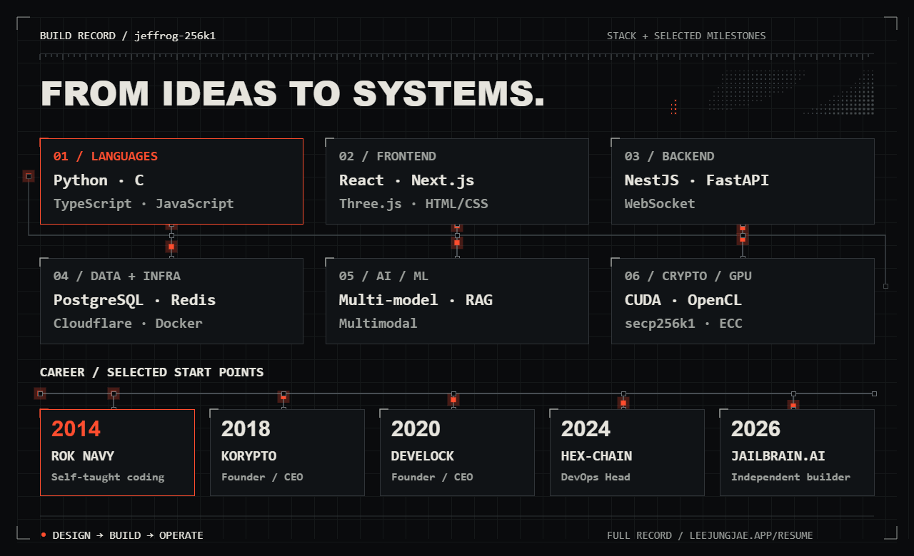
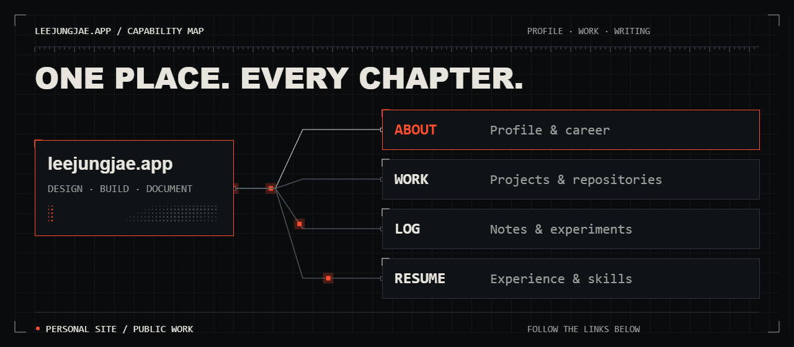
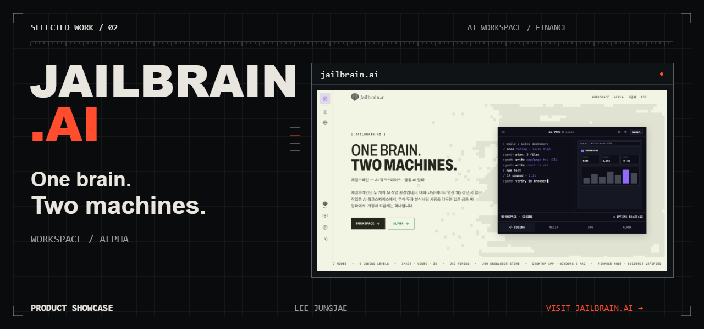
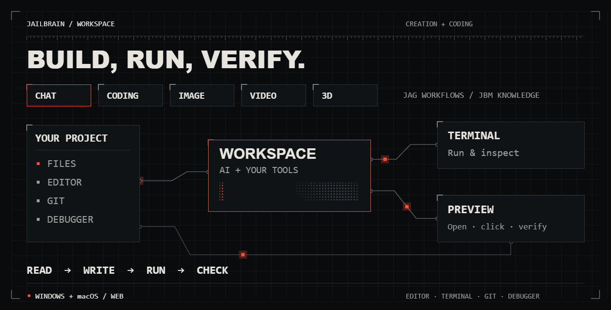
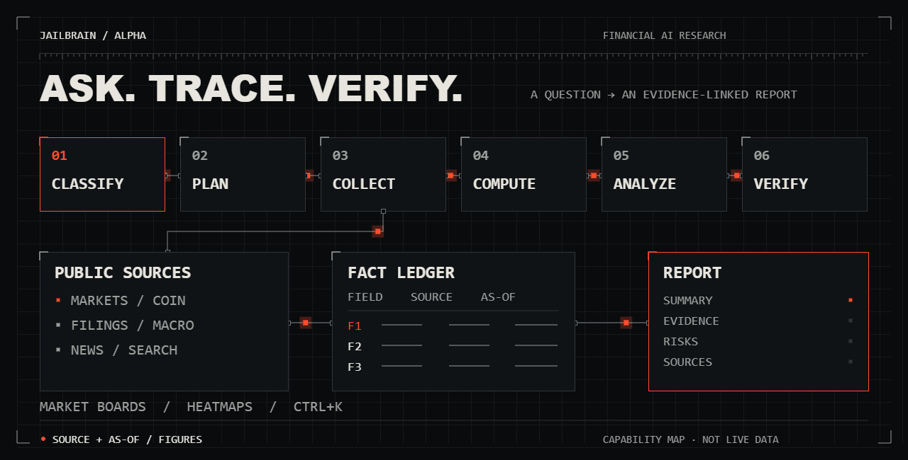

<a href="https://leejungjae.app">
  <picture>
    <source media="(prefers-reduced-motion: reduce)" srcset="assets/profile-static.png?v=2">
    
  </picture>
</a>

<a href="assets/profile-static.png?v=2">정지 이미지로 보기 · Still image</a>

### 이정재 · Jungjae Lee

아이디어를 직접 설계하고, 만들고, 운영합니다.  
앱과 도구, AI 제품을 만들며 배운 것을 기록합니다.

**Currently building → [jailbrain.ai](https://jailbrain.ai)**

[Website](https://leejungjae.app) · [Work](https://leejungjae.app/work) · [Log](https://leejungjae.app/log) · [Resume](https://leejungjae.app/resume)

---

### 01 / Selected work

**[leejungjae.app](https://leejungjae.app)** — 이력서 · 포트폴리오 · 개발 기록  
만든 것과 만드는 과정을 기록하는 개인 공간입니다. 작업, 경력, 글을 하나의 사이트에서 이어 볼 수 있습니다.

<a href="https://leejungjae.app">
  <picture>
    <source media="(prefers-reduced-motion: reduce)" srcset="assets/build-record-static.png">
    
  </picture>
</a>

<a href="https://leejungjae.app">
  <picture>
    <source media="(prefers-reduced-motion: reduce)" srcset="assets/portfolio-map-static.png">
    
  </picture>
</a>

정지 도식 보기 · <a href="assets/build-record-static.png">Build record</a> · <a href="assets/portfolio-map-static.png">Site map</a>

**[jailbrain.ai](https://jailbrain.ai)** — AI 워크스페이스 · 금융 AI 알파  
만드는 일을 위한 **Workspace**, 금융 리서치를 위한 **Alpha**. 두 제품을 각각 데스크톱 앱으로 설치할 수 있으며, 같은 계정·요금제·크레딧을 공유합니다. **[앱 비교·다운로드 →](https://jailbrain.ai/download)**

#### A / Workspace — 만들고, 실행하고, 확인합니다

<a href="https://jailbrain.ai/download/workspace">
  <picture>
    <source media="(prefers-reduced-motion: reduce)" srcset="assets/workspace-map-static.png">
    
  </picture>
</a>

- 대화·코딩·이미지·영상·3D 작업을 한곳에서 수행합니다. JAG로 작업 노드를 연결하고 JBM에 지식을 이어갑니다.
- 데스크톱 앱에서는 **편집기·터미널·Git·디버거**를 한 창에서 사용하며, AI가 연 폴더의 파일을 읽고 수정하고 실행합니다.
- 만든 화면을 열어 클릭·입력하며 확인하는 흐름까지 이어집니다.

**[Workspace 기능·다운로드 →](https://jailbrain.ai/download/workspace)** · Windows / macOS · [정지 도식](assets/workspace-map-static.png)

#### B / Alpha — 질문에서 근거 있는 보고서까지

<a href="https://jailbrain.ai/download/alpha">
  <picture>
    <source media="(prefers-reduced-motion: reduce)" srcset="assets/alpha-map-static.png">
    
  </picture>
</a>

- 종목·지수·코인·금리 질문을 **분류 → 계획 → 수집 → 계산 → 분석 → 검증**의 단계형 리서치로 처리합니다.
- 보고서 수치를 팩트 원장과 연결하고 **출처·기준 시각**을 함께 표시합니다.
- 전용 앱에서 리서치 터미널·시장 판·대화 내역을 사용하고, `Ctrl+K` / `⌘K`로 화면·종목·대화에 이동합니다.

**[Alpha 기능·다운로드 →](https://jailbrain.ai/download/alpha)** · Windows / macOS · [정지 도식](assets/alpha-map-static.png)

위 도식은 공개 기능을 요약한 모션 그래픽입니다. 실제 실행 상태·시세·투자 성과를 표시하지 않으며, 최신 제공 기능과 이용 조건은 각 공식 페이지에서 확인할 수 있습니다.

두 서비스의 소스코드는 비공개입니다. 공개된 서비스와 소개 자료를 통해 작업을 보여드립니다.

---

### 02 / Field notes

작은 실험부터 제품을 운영하며 배운 것까지.  
**[개발 기록 읽기 →](https://leejungjae.app/log)**

LEE JUNGJAE / JEFFROG-256K1 · Life is short, Build fast.
